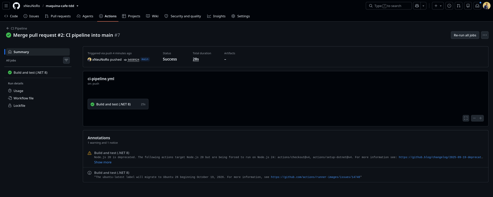

# Máquina de Café - Práctica de TDD (C#)

Proyecto para **Introducción a la Ingeniería de Software**, desarrollado en C# y .NET 8 a partir de la práctica de TDD «Máquina de Café».

**Autor:** Angel Gonzalez · 2025-1122

## Requisitos

- .NET SDK 8.0.
- Internet para restaurar los paquetes de pruebas de NuGet.

## Ejecutar

```bash
dotnet run --project src/MaquinaCafe/MaquinaCafe.csproj
```

La aplicación permite elegir el tamaño de vaso y las cucharadas de azúcar; valida las existencias antes de descontar los recursos.

## Pruebas TDD

```bash
dotnet test MaquinaCafe.sln
```

El proyecto utiliza xUnit con **21 pruebas** que cubren vasos, cafetera, azucarero y preparación de café.

## Integración continua (CI)

El workflow [CI Pipeline](.github/workflows/ci-pipeline.yml) se ejecuta automáticamente al realizar un `push` en `main`, `develop` o ramas `feature/**`, y al abrir o actualizar pull requests hacia `main` o `develop`.

En GitHub Actions, un runner Ubuntu configura .NET 8, restaura dependencias, compila la solución en modo Release y ejecuta las pruebas xUnit. No hay despliegue a producción porque la práctica solicita automatizar la compilación, no publicar un servidor.

[Ver ejecuciones en GitHub Actions](https://github.com/xNeuNoRo/maquina-cafe-tdd/actions/workflows/ci-pipeline.yml)

### Evidencia del pipeline

<!-- Pendiente: subir la captura real de una ejecución correcta de Actions con el nombre docs/evidencias/ci-pipeline.png. -->


## Estructura

```text
src/MaquinaCafe/           Aplicación de consola (.NET 8)
tests/MaquinaCafe.Tests/   Pruebas unitarias (xUnit)
.github/workflows/        Pipeline de GitHub Actions
docs/evidencias/           Captura de la ejecución
MaquinaCafe.sln            Solución .NET
```
